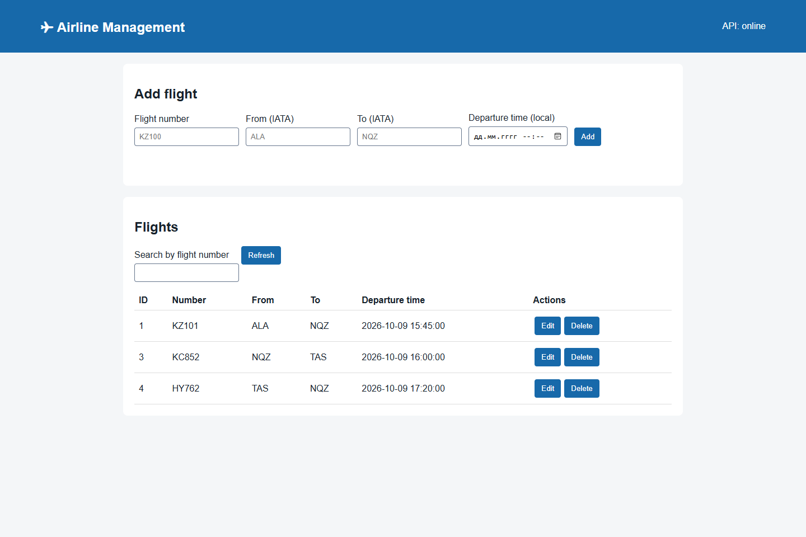

# Airline API

A Java 17 and Spring Boot 4.0.2 learning project for managing flight records in PostgreSQL, with a bundled HTML/CSS/JavaScript interface.



[Mobile preview](docs/screenshots/airline-mobile.png). The screenshots use demonstration records in a temporary test database.

## Features and architecture

- Flight CRUD at `/flights`, with a browser interface at `http://127.0.0.1:8080`.
- Validated request DTOs and normalized flight numbers and airport codes.
- Problem Details responses for invalid input (400) and missing flights (404).
- Flyway schema migrations; Hibernate validates the schema without changing it.
- Service and MVC regression tests, H2 integration tests, and PostgreSQL integration checks in GitHub Actions.

```text
HTTP -> FlightController -> FlightServiceImpl -> FlightRepository -> PostgreSQL
```

The controller maps request DTOs to entities and returns response DTOs. The service owns transactions. Reading, updating, or deleting an absent flight raises the existing domain `FlightNotFoundException`, mapped by `FlightExceptionHandler` to a safe 404 response. `ApiExceptionHandler` handles invalid input. Database failures are not disguised as missing flights.

`FlightFactory`, `Printable`, and `DataPool` remain learning examples outside this HTTP flow.

## Requirements

- JDK 17, with matching `java` and `javac` on PATH.
- A running PostgreSQL server for the application. CI verifies PostgreSQL 16.
- Network access on the first Gradle Wrapper run; a separate Gradle installation is unnecessary.

## Database setup

Create a dedicated role and a **new empty database** through an administrator's `psql` session:

```sql
CREATE ROLE airline_app LOGIN;
\password airline_app
CREATE DATABASE airline OWNER airline_app;
```

`\password` prompts interactively. The application role must be able to create tables in its database. Flyway applies [V1__create_flights.sql](src/main/resources/db/migration/V1__create_flights.sql), then Hibernate validates the mapped columns.

An existing database may contain tables created by earlier Hibernate `ddl-auto=update` versions. Back it up and verify a separate migration plan before using it. Automatic baseline is disabled. Do not delete existing tables or enable baseline just to make startup succeed; use a new database for a local demonstration.

## Configuration and run

Spring Boot reads the standard process environment variables; neither Spring Boot nor the wrapper automatically loads `.env`. [.env.example](.env.example) is a reference containing no real credentials.

| Variable | Meaning |
| --- | --- |
| `SPRING_DATASOURCE_URL` | Required PostgreSQL JDBC URL |
| `SPRING_DATASOURCE_USERNAME` | Database role |
| `SPRING_DATASOURCE_PASSWORD` | Set privately in the shell or IDE |
| `SERVER_ADDRESS` | Listening address, default `127.0.0.1` |
| `SERVER_PORT` | HTTP port, default `8080` |
| `JAVA_HOME` | JDK installation directory |

PowerShell, from the repository root:

```powershell
$env:SPRING_DATASOURCE_URL = 'jdbc:postgresql://localhost:5432/airline'
$env:SPRING_DATASOURCE_USERNAME = 'airline_app'
$env:SPRING_DATASOURCE_PASSWORD = [System.Net.NetworkCredential]::new('', (Read-Host 'Database password' -AsSecureString)).Password
.\gradlew.bat bootRun
```

Linux/macOS:

```bash
export SPRING_DATASOURCE_URL='jdbc:postgresql://localhost:5432/airline'
export SPRING_DATASOURCE_USERNAME='airline_app'
read -rsp 'Database password: ' SPRING_DATASOURCE_PASSWORD; echo
export SPRING_DATASOURCE_PASSWORD
./gradlew bootRun
```

Open `http://127.0.0.1:8080`. The interface calls the API on the same origin, including when `SERVER_PORT` changes. Stop with Ctrl+C.

## API

Responses contain a flight object or array directly. The list can be filtered in the browser; there is no backend search endpoint.

| Method | Path | Success | Missing record |
| --- | --- | --- | --- |
| GET | `/flights` | 200, array | N/A |
| GET | `/flights/{id}` | 200, flight | 404 |
| POST | `/flights` | 201, created flight | N/A |
| PUT | `/flights/{id}` | 200, updated flight | 404 |
| DELETE | `/flights/{id}` | 204, empty body | 404 |

POST/PUT body:

```json
{
  "flightNumber": "KZ100",
  "fromAirport": "ALA",
  "toAirport": "NQZ",
  "departureTime": "2026-11-01T14:30:00"
}
```

Responses add a generated numeric `id`. Flight numbers contain 1–10 Latin letters, digits, or hyphens. Airport codes contain three Latin letters; departure and arrival must differ. Codes and flight numbers are trimmed and uppercased. This validates IATA code format, not membership in an external airport registry. Dates use `LocalDateTime` without a timezone; historical flights are allowed.

Missing flights preserve the current API contract:

```json
{
  "title": "Not Found",
  "status": 404,
  "detail": "Flight not found",
  "instance": "/flights/999"
}
```

The response content type is `application/problem+json`. The omitted default `type` means `about:blank`. Invalid fields return 400 with an `errors` object; malformed JSON, dates, and nonnumeric IDs also return 400.

The browser uses the actual API fields (`id`, `flightNumber`, `fromAirport`, `toAirport`, `departureTime`) and renders text without inserting API values as HTML. Mobile records use cards with edit/delete actions.

## Tests and packaging

```powershell
.\gradlew.bat build
```

On Linux/macOS use `./gradlew build`. This compiles, runs the full suite, and packages the application. By default, the test profile uses temporary in-memory H2 and applies the same Flyway migration. No application database settings are needed. H2 alone does not prove PostgreSQL compatibility.

Tests cover configuration binding, service failure handling, MVC responses, full persisted CRUD, normalization, invalid fields/JSON/dates/IDs, and preservation of an existing record after invalid PUT. Configuration tests hide the test-only H2 driver to exercise the production PostgreSQL-only runtime.

GitHub Actions also starts a separate empty PostgreSQL 16 service, applies Flyway, validates Hibernate mappings, and runs the context and HTTP CRUD integration tests against it. To repeat this locally, create a separate disposable PostgreSQL database, then set:

```powershell
$env:TEST_DATABASE_URL = 'jdbc:postgresql://localhost:5432/airline_test'
$env:TEST_DATABASE_DRIVER = 'org.postgresql.Driver'
$env:TEST_DATABASE_USERNAME = 'airline_app'
$env:TEST_DATABASE_PASSWORD = [System.Net.NetworkCredential]::new('', (Read-Host 'Test database password' -AsSecureString)).Password
.\gradlew.bat test --rerun-tasks --tests '*FlightApiIntegrationTests' --tests '*AirlineApi2ApplicationTests'
```

These tests clear `flights` between cases. **Never point `TEST_DATABASE_*` at a database containing user data.** Use only the disposable test database; these variables do not configure a normal application launch. Unset them to return tests to H2.

Reports: `build/reports/tests/test/index.html`. Executable JAR: `build/libs/airline-api-0.0.1-SNAPSHOT.jar`; run it with `java -jar` and the standard `SPRING_DATASOURCE_*` variables above.

The screenshots document desktop/mobile layouts. Automated backend tests do not establish live browser behavior or a production deployment.

## Limitations

This is a local learning demonstration with no authentication or authorization. Changing data requires no login. Public deployment needs a separate security and deployment design. It has no passengers, bookings, capacity, payments, pagination, or timezone handling. Arbitrary cross-origin access is not enabled; the built-in interface uses the API origin.

A previously committed database password remains in published Git history. If it was used for a real database, its owner must rotate it. Environment configuration does not revoke an old password; repository history is not rewritten.
